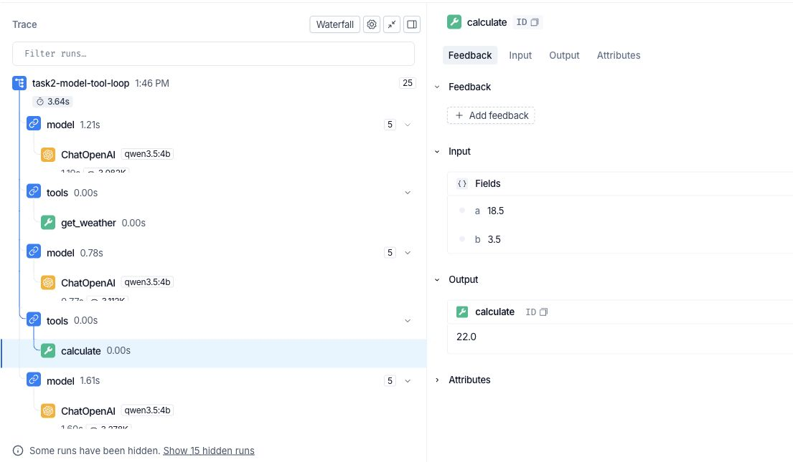

# Task2 学习笔记 · 第一个 Deep Agent

源码在 [`examples/task2/agent.py`](../../examples/task2/agent.py)。示例沿用 Task1 的 Python 依赖锁和本地 Ollama，通过 `ChatOpenAI` 向本地兼容接口发送模型请求。天气和计算都在示例中执行，LangSmith 收集本次验收的调用链。

## 一次 `invoke()` 怎样运行

| 层次 | 在示例里的工作 |
| --- | --- |
| Runtime · LangGraph | 执行编译后的图，维护消息状态，调度下一轮模型或工具节点。 |
| Framework · LangChain | 适配模型接口，将函数转换成工具 Schema，并把工具结果作为 `ToolMessage` 交回模型。 |
| Harness · Deep Agents | 通过 `create_deep_agent()` 组装模型、应用注册的工具和 Harness 提供的能力。 |

三层自底向上组合。LangSmith 将图、模型和工具调用记录到同一条 Trace 中，可以用它检查环节、顺序和耗时。 [第 1 章 · Agent Harness](https://datawhalechina.github.io/deepagents-in-action/chapters/ch01-agent-harness/)

## 环境和操作

使用项目锁定的 Deep Agents `0.7.8`，Python 版本范围为 `>=3.12,<3.14`。如果 Ollama 尚未启动，另开终端运行 `ollama serve`，并用 `ollama pull qwen3.5:4b` 获取模型。随后在仓库根目录依次运行三个示例。 [第 2 章 · 快速上手](https://datawhalechina.github.io/deepagents-in-action/chapters/ch02-quickstart/)

```sh
export NO_PROXY="${NO_PROXY:+$NO_PROXY,}127.0.0.1,localhost"
export no_proxy="$NO_PROXY"

LANGSMITH_TRACING=false uv run --frozen python examples/task2/agent.py --step weather
LANGSMITH_TRACING=false uv run --frozen python examples/task2/agent.py --step calculator
LANGSMITH_TRACING=true uv run --frozen --env-file .env python examples/task2/agent.py --step both
```

1. `weather` 注册 `get_weather(city: str)`。输入北京后，函数返回固定文本 `It's always sunny in 北京!`，最终回复注明天气是演示数据。
2. `calculator` 注册 `calculate`。`a: float`、`b: float` 表示两个数值，`operation` 用 `Literal` 限定加、减、乘、除。docstring 解释工具用途和省略 `operation` 的含义，`"add"` 是函数默认值。给两个数 `18.5` 和 `3.5`，核对调用参数里略去 `operation`，并查看工具返回值。
3. `both` 注册两个工具，用一次 `agent.invoke()` 完成两步。示例逐条打印 `AIMessage.tool_calls` 和匹配的 `ToolMessage`，再输出最终回复。启用追踪时，程序会等待 Trace 发送，并打印根 Trace ID。

`TASK2_MODEL`、`TASK2_OPENAI_BASE_URL` 和 `TASK2_OPENAI_API_KEY` 可在当前进程覆盖模型连接。默认使用 `qwen3.5:4b`、`http://127.0.0.1:11434/v1` 和本地客户端占位值 `ollama`。组合步骤通过 `--env-file .env` 读取本地 `LANGSMITH_API_KEY` 与按工作区区域设置的 `LANGSMITH_ENDPOINT`，Trace 写入独立项目 `deepagents-task2`。

## 排查记录

- **兼容接口和额度。** Task1 曾遇到硅基流动余额不足，这次复用已经可用的本地模型。模型推理走 Ollama，LangSmith 只接收本实验的追踪数据。有代理的环境里，把 `127.0.0.1` 和 `localhost` 加入 `NO_PROXY`，让本机请求直达。
- **终端能否找到 `uv`。** 本机的 `uv` 位于 `~/.local/bin`。第一次在非交互终端用 `uv` 启动组合步骤时遇到 `command not found`，把该目录加到当前终端的 `PATH` 后重新执行。
- **模拟天气的表述。** 第一次 Hello World 已经触发工具，但模型把固定文本转述成真实天气。给工具的 docstring 和问题补上“模拟数据”的含义后再跑，验收时一并查看工具结果和最终回答。
- **默认值的证据。** `22.0` 本身只能确认计算结果。再读 `AIMessage.tool_calls` 的原始参数和匹配的 `ToolMessage`，才能确认 `operation` 确实由 Python 工具默认填入。

## 实测与验收

2026 年 11 月 17 日在本机用 `qwen3.5:4b` 跑通 `weather`、`calculator` 和 `both`。我在 LangSmith 的 `deepagents-task2` 追踪项目里打开 `task2-model-tool-loop`，沿树查看 `ChatOpenAI`、`get_weather`、`ChatOpenAI`、`calculate`、`ChatOpenAI`，并点开 `calculate` 核对原始输入和输出。



**一句话验收** · 一次 `invoke()` 调用了 3 次模型和 2 次工具，先用 `get_weather` 返回北京的模拟天气，再用 `calculate` 在省略 `operation` 的情况下算出 `18.5 + 3.5 = 22.0`，最后由模型汇总。

## 延伸记录

[Task2 学习心得](learning-reflections.md) · [Task2 课程反馈](course-feedback.md)
