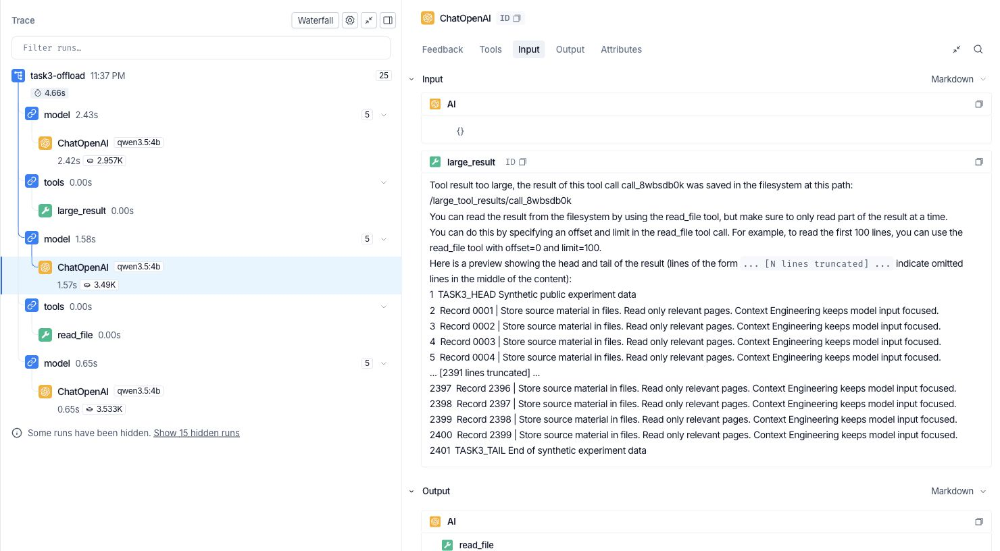

# Task3 学习笔记 · 虚拟文件系统与存储后端

2026 年 11 月 20 日，在现有项目中完成文件工具、默认大结果卸载和三种 Backend 的生命周期实验。源码在 [`examples/task3/filesystem_lab.py`](../../examples/task3/filesystem_lab.py)，精简实测数据在 [`experiment-results.json`](experiment-results.json)。模型沿用本机 Ollama 的 `qwen3.5:4b`，Deep Agents 版本为项目锁定的 `0.7.8`。

## 怎样复现

在仓库根目录运行。Ollama 需要已启动并安装 `qwen3.5:4b`，Python、uv 与 `.env` 的准备见 [Task1 学习笔记](../task1/learning-notes.md)。`.env` 中已有的 LangSmith Key 和 Endpoint 用于上传本实验 Trace，示例将追踪项目设为 `deepagents-task3`。

```sh
export PATH="$HOME/.local/bin:$PATH"
export NO_PROXY="${NO_PROXY:+$NO_PROXY,}127.0.0.1,localhost"
export no_proxy="$NO_PROXY"

LANGSMITH_TRACING=true uv run --frozen --env-file .env \
  python examples/task3/filesystem_lab.py --step all
```

程序打印每次模型运行的 Trace ID，以及本次数据目录。默认目录是 `.task3-runs/<随机标识>/`，其中 `results.json` 保存实验结果，`files-messages.json` 和 `offload-messages.json` 保存消息，`large-result.txt` 保存完整生成材料，`disk/notes/task3.md` 是磁盘 Backend 写下的文件。还可以用 `--output-dir .task3-runs/my-experiment` 指定独立目录。这些运行数据由 `.gitignore` 排除。

用 `--step files`、`--step offload` 或 `--step backends` 可分别复现。单独运行 Backend 对比使用确定性的图节点读写，命令如下。

```sh
LANGSMITH_TRACING=false uv run --frozen \
  python examples/task3/filesystem_lab.py --step backends
```

示例支持 `TASK3_MODEL`、`TASK3_OPENAI_BASE_URL`、`TASK3_OPENAI_API_KEY` 三个进程级覆盖值。默认地址为 `http://127.0.0.1:11434/v1`，默认 Key 为本地客户端占位值 `ollama`。

## 实验一 · Agent 自己写、读、搜

将三个步骤交给一次 `invoke()`，由真实模型按序选择内置工具。

| 顺序 | 实际调用 | 观察结果 |
| --- | --- | --- |
| 1 | `write_file` 写入 `/notes/task3.md` | State 的 `files` 中出现笔记，内容与要求完全一致。 |
| 2 | `read_file` 读取同一路径 | 返回三行笔记，包含 `Context Engineering uses files on demand.`。 |
| 3 | `grep` 在 `/notes/` 搜索 `Context Engineering`，模式为 `content` | 返回笔记路径及匹配的第 2 行。 |

LangSmith 中能核对到 4 次 `ChatOpenAI` 调用和上述 3 次工具调用，所有节点均完成且没有错误。应用层也核对了工具调用 ID、成功状态、实际存储内容和搜索结果。

本章七个文件工具的职责如下。本次模型实验实际执行其中的写入、读取和搜索三项。 [第 3 章课程正文](https://datawhalechina.github.io/deepagents-in-action/chapters/ch03-virtual-filesystem/)

| 工具 | 用途 |
| --- | --- |
| `ls` | 查看目录内容。 |
| `write_file` | 创建或完整覆盖文件。 |
| `read_file` | 按偏移和行数读取内容。 |
| `edit_file` | 对已有文本做精确替换。 |
| `delete` | 删除文件或目录。 |
| `glob` | 按路径模式找文件。 |
| `grep` | 按字面内容搜索，选择文件名、内容或计数输出。 |

## 实验二 · 默认大结果卸载

自定义 `large_result()` 生成公开的合成资料，共 2,401 行、285,492 个字符。开头和末尾分别带 `TASK3_HEAD`、`TASK3_TAIL` 标记，第 1,201 行放置目标文字。创建 Agent 时使用默认文件中间件，工具结果阈值为估算 20,000 tokens，当前实现按每 token 4 个字符判断，对应 80,000 字符。

模型先调用 `large_result`。中间件将全文写入 `/large_tool_results/call_8wbsdb0k`，把交回模型的工具消息替换成路径和首尾各五行预览。路径中的调用标识随每次运行变化。接着模型调用 `read_file`，参数是 `offset=1200`、`limit=1`，成功读回目标行。

| 检查项 | 本次实测 |
| --- | --- |
| 原始工具输出 | 285,492 字符 |
| 下一轮模型收到的该条工具消息 | 1,733 字符 |
| 首尾预览 | 可见开头、结尾和 `2391 lines truncated` 提示 |
| 中间目标行 | 预览省略，分页读取后获得 |
| 全文完整性 | State 中保存的内容与生成文本逐字相等，SHA-256 为 `030b04431e51a97dc6b167fec69230edfbf6c3a1c3c899572b396fe03605f89c` |
| 模型与工具次数 | 3 次模型，2 次工具 |

我在 LangSmith 点开卸载之后的第二次 `ChatOpenAI`，展开 Input 中的 `large_result` 工具消息，看到了文件引用、首尾预览和省略行数。随后通过云端 Trace 导出，对比原始工具节点的完整输出和下一次模型输入，确认字符数分别为 285,492 与 1,733。



这两个数都按字符计量。默认阈值中的 token 数是中间件的长度估算；分析实际模型用量时，应逐轮查看模型节点的 usage，再汇总整个 Trace。通用卸载适用于本实验这样的自定义大结果工具，内置读取与搜索工具另有分页或截断逻辑。 [Deep Agents 0.7.8 文件中间件](https://github.com/langchain-ai/deepagents/blob/deepagents%3D%3D0.7.8/libs/deepagents/deepagents/middleware/filesystem.py)

## 实验三 · Backend 生命周期对比

为确保比较的是存储行为，使用同一段 LangGraph 节点调用真实 Backend 的 `write()` 和 `read()`，检查读到的正文。State 操作在图执行上下文内完成，每组使用独立的 `InMemorySaver` 和 `InMemoryStore`。每组依次做同线程读取、新线程读取、复用资源重建图读取，然后启动独立 Python 子进程再次读取。

| Backend 与本次配置 | 文件存储位置 | 同线程读回 | 新线程读回 | 复用原资源重建图 | 新进程读回 |
| --- | --- | --- | --- | --- | --- |
| `StateBackend` + `InMemorySaver` | 线程 State 的 `files`，由内存 Checkpointer 保存 | 是 | 否 | 是 | 否 |
| `FilesystemBackend` + `virtual_mode=True` | 本次数据目录的 `disk/notes/task3.md` | 是 | 是 | 是 | 是 |
| `StoreBackend` + `InMemoryStore` | Store 中的 `("task3", "learner")` 命名空间 | 是 | 是 | 是 | 否 |

新进程使用同一个磁盘根目录、相同 Store 命名空间和相同线程名，但创建新的内存 Saver、Store。因此实测说明，本配置下磁盘文件可跨进程保存，内存 State 和内存 Store 随进程资源生命周期结束而丢失。State 若改用持久化 Checkpointer，可以恢复原线程状态；Store 若需要跨进程保存，也要配置持久化 Store。 [LangGraph 持久化说明](https://docs.langchain.com/oss/python/langgraph/persistence)

选择后端时，我会先看资料需要活多久。单线程草稿可放 State，本地文件产物可放 Filesystem，需要多线程共享的资料可放 Store，并按实际保存期限选择存储实现。路径 `/notes/task3.md` 在三组里相同，数据位置由 Backend 决定。

## 排查与版本差异

- **本地虚拟路径。** 磁盘实验将 `root_dir` 指向本次数据目录的 `disk/`，显式设置 `virtual_mode=True`。因此虚拟路径 `/notes/task3.md` 对应根目录内部的 `notes/task3.md`。
- **State 的运行上下文。** 当前 `StateBackend()` 从 LangGraph 配置读取和更新 `files`。将它放在图节点里调用，才能检查真实线程状态。初始化内容也可通过 Agent 输入的 `files` 传入。
- **命名空间。** Store 实验使用固定的本地演示命名空间。课程的部署示例通过 `runtime.server_info.user.identity` 获取用户身份，本地直接 `invoke()` 时需选择适合本地环境的 namespace。
- **偏移量。** `offset` 从零开始，读取第 1,201 行需传 `1200`。脚本同时核对参数和读回的目标文字。
- **检查完整链路。** LangSmith 里的原工具节点仍记录完整输出，查看下一轮模型 Input 才能确认中间件处理后的内容。本次同时核对两处数据和 State 中保存的全文。

## 一句话验收

Agent 完成写笔记、读回和搜索，把 285,492 字符的工具结果卸载成 1,733 字符的引用与预览后读回中间目标行，并通过三个新进程实验确认三种 Backend 的保存范围。

本次完成后，既有 6 个测试全部通过，`agentseek doctor --live` 确认研究助手前后端可达。Task1 原会话仍有 3 次成功运行，保存报告的内容校验与实验开始前一致。

[Task3 学习心得](learning-reflections.md) · [Task3 课程反馈](course-feedback.md)
