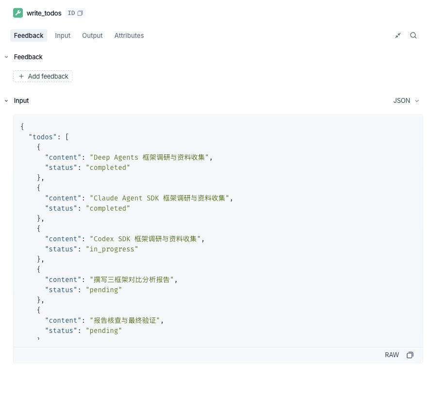

# Task4 学习笔记 · 任务规划与分解

2026 年 11 月 23 日，在现有项目内完成显式规划、三大 Harness 研究报告和问题复盘。使用锁定的 Deep Agents `0.7.8`、LangChain 和本机 Ollama `qwen3.5:4b`，搜索使用已有 Tavily 配置。 [第 4 章课程正文](https://datawhalechina.github.io/deepagents-in-action/chapters/ch04-task-planning/)

## 运行入口

源码在 [`examples/task4/research_agent.py`](../../examples/task4/research_agent.py)。在仓库根目录执行，Ollama 与模型沿用前面任务的准备。

```sh
export PATH="$HOME/.local/bin:$PATH"
export NO_PROXY="${NO_PROXY:+$NO_PROXY,}127.0.0.1,localhost"
export no_proxy="$NO_PROXY"

LANGSMITH_TRACING=true uv run --frozen --env-file .env \
  python examples/task4/research_agent.py
```

程序使用 `TASK4_MODEL`、`TASK4_OPENAI_BASE_URL`、`TASK4_OPENAI_API_KEY` 接收当前进程的模型覆盖值，默认连接本机 Ollama。`.env` 提供 `TAVILY_API_KEY`、`LANGSMITH_API_KEY` 和对应的 LangSmith Endpoint，追踪项目为 `deepagents-task4`。

输出默认保存在 `.task4-runs/<随机标识>/`，可以用 `--output-dir` 指定独立目录。目录内有 `results.json`、`todo-timeline.json`、`messages.json`、`searches.json`、`virtual-files.json` 和模型生成的 `harness-comparison.md`。程序退出前会等待 Trace 发送并打印根 Trace ID。生成数据由 `.gitignore` 排除。

本次验收数据位于 `.task4-runs/acceptance-v1.4-final/`。已发布的 [精简实测记录](experiment-results.json) 和 [研究报告复核稿](research-report.md) 便于从 GitHub 查看结果。

## 怎样显式启用规划

```python
from deepagents import create_deep_agent
from langchain.agents.middleware import TodoListMiddleware

agent = create_deep_agent(
    model=model,
    tools=[internet_search],
    middleware=[TodoListMiddleware()],
    checkpointer=saver,
)
```

`TodoListMiddleware` 提供 `write_todos`、`todos` 状态和规划提示词。每次更新传完整清单。Checkpointer 则负责保存线程状态，本实验使用进程内的 `InMemorySaver`。文件笔记与报告继续使用默认 StateBackend。 [LangChain 规划中间件](https://docs.langchain.com/oss/python/langchain/middleware/built-in#to-do-list)

实验通过 `agent.stream(..., stream_mode="values")` 保留每次变化后的真实 `todos`。流结束时，最后一个 State 就是代码中的 `result`，从 `result.get("todos", [])` 检查最终清单，并与 Checkpointer 中的同线程状态核对。

## 最终运行的规划与执行

模型自己生成了五项任务，初始全部为 `pending`。共观察到七个不同的清单版本。

| 清单版本 | Deep Agents 调研 | Claude 调研 | Codex 调研 | 写报告 | 核查报告 |
| --- | --- | --- | --- | --- | --- |
| 1 | pending | pending | pending | pending | pending |
| 2 | in_progress | pending | pending | pending | pending |
| 3 | completed | in_progress | pending | pending | pending |
| 4 | completed | completed | in_progress | pending | pending |
| 5 | completed | completed | completed | in_progress | pending |
| 6 | completed | completed | completed | completed | in_progress |
| 7 | completed | completed | completed | completed | completed |

最终 Trace 核对到 11 次模型调用、15 次工具调用，其中 `write_todos` 7 次、`internet_search` 3 次、`write_file` 4 次、`read_file` 1 次。最终运行的工具没有报错，云端各次清单更新与本机流记录相同。

每个框架做一次 Tavily 检索，再由工具读取预先选定的对应官方概览 Markdown 正文。检索域名限定为相关官方文档站点。这个实验用固定概览控制研究范围，最终报告围绕正文中的能力展开。

| 清单任务 | 实际执行证据 | 最终产物 |
| --- | --- | --- |
| 调研 Deep Agents | 对应查询和官方概览正文 | `/research/deep-agents.md`，报告中对应章节与来源 |
| 调研 Claude Agent SDK | 对应查询和官方概览正文 | `/research/claude-agent-sdk.md`，报告中对应章节与来源 |
| 调研 Codex SDK | 对应查询和官方概览正文 | `/research/codex-sdk.md`，报告中对应章节与来源 |
| 撰写报告 | `write_file` 保存全文 | `/research/harness-comparison.md`，原稿 42 行 |
| 核查报告 | `read_file(offset=0, limit=300)` | 读回全文，随后最后一项变为 completed |

## 对照 LangSmith

打开 `deepagents-task4` 项目中的 `task4-harness-research`。逐次点开 `write_todos`，查看 Input 中完整清单的 `content`、`status`，再与根运行 Output 中的最终 `todos` 对照。应用层另外导出 Trace，核对工具顺序、模型次数、七次清单输入和最终状态。



## 问题复盘

第二轮特别适合检查“清单对照产物”。该轮 `result.get("todos", [])` 已全部完成，Trace 实际有 6 次 `write_todos`、3 次搜索、2 次写文件和 1 次读取。但核查任务只出现 `pending → completed`，三份独立框架笔记也没有全部写出。报告还把检索摘要中的 API 平台导航词条写成 Codex SDK 的能力。这些问题需要结合状态历史、文件列表和正文检查才能发现。

| 运行 | 实际问题 | 处理与结论 |
| --- | --- | --- |
| 首轮 | 清单一直为 pending，已做 8 次搜索，集中重复细分查询 | 中止并保留记录，明确每框架一次查询与搜索前更新状态。 |
| 第二轮 | 最终全完成，但核查跳过进行中状态，框架笔记不齐，报告误用导航词条 | 指定三份笔记路径，逐项检查三态，读取官方正文。 |
| 第三轮 | 一次 `write_todos` 将 content 错写成 checklist，被 Schema 拒绝后模型自纠正 | 保留错误和后续修正。验收程序也改为记录工具错误，再检查最终结果。该轮长报告通过两次读取完成分页。 |
| 最终轮 | 五项完整流转，三份笔记和报告均存在，全文读回；生成稿遗漏对比表且夹杂英文 | 自动结构检查通过，人工复核补充对比表、整理中文，并记录改动范围。 |

自动检查覆盖状态流转、最终清单、笔记存在、报告章节与来源、报告读回。报告的事实归属、表格是否有信息量，以及场景建议是否由证据支持，仍由正文复核完成。本次发布的是 [研究报告复核稿](research-report.md)，本地同时保留模型原稿。

最终 Trace 还显示，同一轮模型响应有时会请求多个工具，其中一次搜索工具比同轮的清单更新先启动。示例设置了 `parallel_tool_calls=False` 并在提示词中要求逐次调用，本地兼容模型仍出现了这个行为。实测记录同时保留消息中的请求排列与云端工具启动顺序，并按工具名和参数逐一核对。若应用要求严格的执行依赖，还需在图或工具调度层实现约束，Todo 清单本身负责记录进度。

## 心得与验收

规划让步骤可见，产物检查让完成标记有依据。本次验收确认五项任务完整经历三态，实际执行了搜索、笔记写入、报告写入与读回，并记录了清单跳步、引用误归因和生成稿遗漏的处理过程。

完成后，既有 6 个测试全部通过，`agentseek doctor --live` 确认研究助手前后端可达。Task1 原会话仍保留 3 次成功运行，原报告内容校验与本次开始前一致。

[学习心得](learning-reflections.md) · [课程反馈](course-feedback.md)
