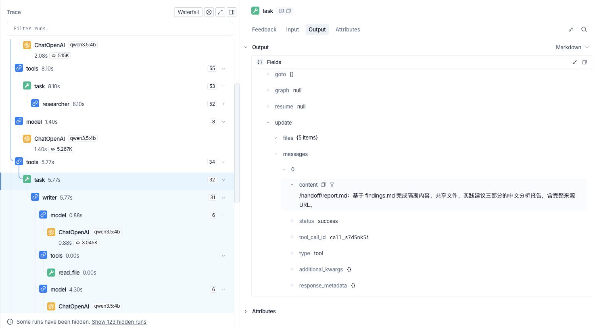

# Task5 学习笔记 · 子 Agent 与上下文隔离

2026 年 11 月 26 日，使用现有项目的 Deep Agents `0.7.8` 和本机 Ollama `qwen3.5:4b`，跑通研究员收集分析、写手成文、主 Agent 验收的同步流水线。 [课程章节](https://datawhalechina.github.io/deepagents-in-action/chapters/ch05-subagents/)

## 角色设计

源码在 [`examples/task5/subagent_pipeline.py`](../../examples/task5/subagent_pipeline.py)。两个专用子 Agent 都用字典提供 `name`、`description`、`system_prompt`，并显式指定应用工具、Skills 与中间件。

| 角色 | 职责 | 工具与状态 | 文件分工 |
| --- | --- | --- | --- |
| 主 Agent | 委派、等待交接、读回验收 | `task`、自己的 Todo、文件读取工具 | 读取结果，文件写入权限关闭 |
| researcher | 从固定版本官方源码收集和分析事实 | `collect_reference`、独立 Todo、自己的 Skills 和内置文件工具 | 写 `/handoff/findings.md` |
| writer | 读取发现并整理中文报告 | 应用工具列表为 `[]`，内置文件工具仍可用，自己的 Skills | 读发现，写 `/handoff/report.md` |

库另带 `general-purpose` 子 Agent，本次两次委派使用的是 researcher 和 writer。三个角色复用本地模型与 StateBackend，声明式子 Agent 的工具和中间件按各自配置组装。

## 怎样复现

在仓库根目录执行。模型与基础工具沿用 [Task1 环境](../task1/learning-notes.md)，`.env` 中已有的 LangSmith 配置用于本实验追踪。

```sh
export PATH="$HOME/.local/bin:$PATH"
export NO_PROXY="${NO_PROXY:+$NO_PROXY,}127.0.0.1,localhost"
export no_proxy="$NO_PROXY"

LANGSMITH_TRACING=true uv run --frozen --env-file .env \
  python examples/task5/subagent_pipeline.py
```

程序支持 `TASK5_MODEL`、`TASK5_OPENAI_BASE_URL`、`TASK5_OPENAI_API_KEY` 覆盖本次进程的模型连接，默认连接本机 Ollama。研究工具通过 HTTPS 读取版本固定的官方源码。LangSmith 项目名为 `deepagents-task5`。

默认数据目录为 `.task5-runs/<随机标识>/`，也可用 `--output-dir` 指定独立目录。`contexts.json` 保存三个角色的观测，`results.json` 保存验收结果，`findings.md` 和 `report.md` 保留模型产物。运行数据由 `.gitignore` 排除。本次最终记录在 `.task5-runs/acceptance-v1.5-final/`，GitHub 提供 [精简实测数据](experiment-results.json) 与 [报告复核稿](pipeline-report.md)。

## 本次观察到了什么

主 Agent 先维护自己的 Todo，再通过内置 `task` 委派给 researcher。研究员读取官方源码、写发现并返回摘要。主 Agent 等待其完成后，再委派 writer；写手读取共享发现，写报告并返回简短结果。主 Agent 最后读回报告验收。云端 Trace 的开始、结束时间确认，研究员先完成，写手后启动。

| 角色 | 模型调用 | 工具请求 | 主对话收到的子任务结果 |
| --- | --- | --- | --- |
| 主 Agent | 7 | Todo 2 次、task 2 次、read_file 1 次、edit_file 1 次 | 两个 task 响应 |
| researcher | 4 | Todo 2 次、collect_reference 1 次、write_file 1 次 | 182 字符的最终摘要 |
| writer | 3 | read_file 1 次、write_file 1 次 | 71 字符的最终回复 |

合计 14 次模型调用、12 次工具请求。主 Agent 的一次 `edit_file` 请求被其只读文件权限拒绝，报告写入由写手完成。根运行正常结束，拒绝记录作为实测问题保留。

## 一段话说明隔离方式

本次默认委派以新的任务描述作为子 Agent 的初始消息，主对话历史和子任务的中间调用记录各自保存；各角色使用自己的 `system_prompt`，独立加载指定的 Skills，主、子 `todos` 也不互传。主 Agent 的消息更新只收到子 Agent 的最终回答。共用 StateBackend 时，允许传递的 `files` 状态仍然进入子 Agent 并回传更新，因此研究员写下的发现可被后续写手读取，主 Agent 也能读回报告。Skills 文件本身同样在共享 Backend 内，独立的是加载范围和技能元数据。 [0.7.8 委派实现](https://github.com/langchain-ai/deepagents/blob/deepagents%3D%3D0.7.8/libs/deepagents/deepagents/middleware/subagents.py)

## 隔离与共享的实测证据

`ObserveContext` 只记录状态和模型请求，不修改它们。实验标记均为公开的合成字符串。

| 检查项 | 实际结果 |
| --- | --- |
| 主消息历史 | 含 `PARENT_HISTORY_ONLY_MARKER`；两个子 Agent 初始消息各只有新委派描述，没有该标记。 |
| 系统提示词 | 模型请求中仅出现当前角色的系统标记。 |
| Skills | 三个角色分别加载 main-coordination-skill、research-analysis-skill、writing-summary-skill，模型提示中也只出现各自名称。 |
| Todo | 子 Agent 初始没有主 Todo。研究员单独启用并完成自己的清单；写手没有 write_todos 工具，主清单仍由主 Agent 维护。 |
| 原始研究结果 | collect_reference 的工具消息为 3,569 字符，其中的合成标记只出现在研究员消息里。 |
| task 返回 | 两个父级 ToolMessage 分别与两个子 Agent 的最终回答一致。 |
| 文件共享 | 写手进入时已有 findings.md，随后实际 read_file 读到它；父级最终 State 中保留发现和报告。 |

云端两个 `task` 的返回更新都包含 `files` 和一条 `messages`，没有回传子 Agent 的 `todos` 与 Skills 私有元数据。对隔离的判断同时依据本机记录与云端 Trace。



## 踩坑与处理

- **版本不一致。** 首轮读取当前官方概览后，模型引入了本机版本不适用的 mode/fork 说明。后续研究材料改为固定的 `deepagents==0.7.8` 源码片段，并从源码解析实际排除的状态键。
- **Skills 目录规范。** 初始使用通用 role 子目录，名称与 SKILL.md 的 name 不匹配，触发规范警告。现改为以实际技能名命名子目录。
- **交接路径被改写。** 一轮研究员写到 `/app/handoff/findings.md`，写手按 `/handoff/findings.md` 读取失败，主 Agent 随后自行写稿。现统一虚拟根路径，并分别限定角色写入范围。
- **Todo 检测过严。** 最初用固定标题完全相等判断父 Todo，模型补充描述就会被误判。现核对父最终清单是否等于父最后一次更新，并确认其中没有子清单条目。
- **摘要会传递误读。** 最终模型稿把返回状态的 messages 键误读成必须返回 ToolMessage，还写出不应使用 Todo 追踪的建议。人工按源码和实际独立 Todo 记录修正，保留原稿与复核稿差异。

## 一句话验收

主 Agent 依次委派研究员和写手，完成收集、分析、写作与读回验收；消息、提示词、Skills 和 Todo 独立，文件通过共享 Backend 完成交接，模型稿中的误读已在复核稿与实测记录中说明。

完成后，既有 6 个测试全部通过，`agentseek doctor --live` 确认研究助手前后端可达。Task1 原会话仍有 3 次成功运行，原报告内容校验与本次开始前一致。

[学习心得](learning-reflections.md) · [课程反馈](course-feedback.md)
